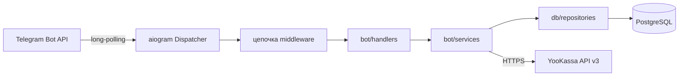
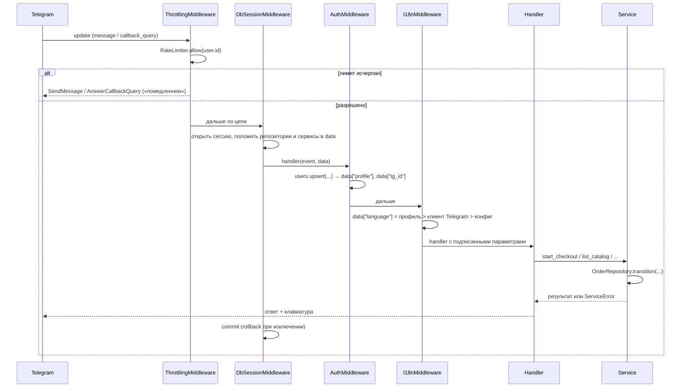

# Архитектура TelegramShopBot

Проект — Telegram-бот для продажи цифровых товаров (курсы, шаблоны,
чек-листы) с оплатой через YooKassa и автоматической выдачей материалов.

## Общий вид

Три жёстких правила, вокруг которых построена архитектура:

1. **Хендлеры не знают про БД.** Ни один `bot/handlers/*.py` не импортирует
   `sqlalchemy` и не пишет запросов — только вызывает сервисы, полученные из
   контекста.
2. **Сервисы не знают про Telegram.** `bot/services/*` оперируют числами,
   строками и доменными ошибками; им неизвестны `Message`, `CallbackQuery`,
   клавиатуры. Благодаря этому бизнес-логика тестируется без эмуляции
   Telegram и переиспользуется (webhook и кнопка ведут в один код).
3. **SQL живёт только в репозиториях.** `db/repositories/*` — единственные,
   кто строит `select()/update()`.

## Слои

| Слой | Путь | Ответственность |
|------|------|-----------------|
| Точка входа | `main.py` | Сборка `Bot`, `Dispatcher`, цепочки middleware, запуск polling |
| Конфигурация | `config.py` | Единый источник настроек из `.env`, строгая валидация (не правится) |
| Транспорт | `bot/handlers/` | Разбор события → вызов сервиса → форматирование ответа |
| Представление | `bot/keyboards/`, `bot/i18n.py` | Кнопки, callback-данные, тексты RU/EN |
| Диалоги | `bot/states/` | Группы FSM-состояний пошаговых опросов |
| Контекст запроса | `bot/middlewares/` | Троттлинг, транзакция, аутентификация, язык |
| Бизнес-логика | `bot/services/` | Пользователи, витрина, заказы/платежи, деньги, HTTP-клиент |
| Данные | `db/repositories/` | Запросы и мутации таблиц |
| Модель | `db/models/` | ORM-описания, enum-ы, mixin-ы |
| Схема | `db/migrations/` | Alembic: единственно допустимый способ менять схему |

## Поток обработки сообщения

### Почему middleware — outer и именно в таком порядке

Регистрация идёт на `dispatcher.message`/`dispatcher.callback_query` как
`outer_middleware`, а не на `dispatcher.update`:

- у объекта `Update` нет `from_user`, поэтому троттлинг и аутентификация на
  уровне апдейта не увидели бы отправителя;
- корневые фильтры роутеров (например, `IsAdminFilter`) проверяются **до**
  inner-middleware — значит `profile` обязан появиться в контексте ещё на
  стадии подбора хендлера, а это возможно только в outer-цепи.

Порядок `Throttling → DbSession → Auth → I18n → ChatAction`:

1. **Throttling** первым — флуд отклоняется до открытия соединения с БД;
2. **DbSession** — один апдейт = одна транзакция и один коммит;
3. **Auth** — требует сессию, чтобы сделать upsert профиля;
4. **I18n** — читает `profile`, поэтому идёт после Auth;
5. **ChatAction** («печатает…») — только на `message`, ближе всех к хендлеру.

Один общий `RateLimiter` на оба типа событий: раздельные лимиты позволили бы
обойти ограничение чередованием «кнопка — команда».

## Роутеры и порядок их подключения

`bot/handlers/__init__.build_routers()` собирает корневой `Router`, и
очерёдность подключения — часть логики, потому что роутеры перехватывают
событие первыми:

1. `admin` — у него корневые фильтры `IsAdminFilter`; для не-админа событие
   просто уходит дальше;
2. `catalog`, `payment` — inline-навигация покупателя;
3. `commands` — точки входа и «подхват» всего нераспознанного текста
   (`handle_menu_navigation` зарегистрирован последним);
4. `errors` — обработчики исключений на корневом роутере.

Роутеры модулей — синглтоны, а aiogram запрещает подключать один роутер к
двум родителям, поэтому `build_routers()` кэширует корень в `_root` и
идемпотентна (повызывается из тестов и из `main`).

## Где живут деньги

- Формат — **целые копейки** (`price_kopecks`, `total_kopecks`,
  `amount_kopecks`), тип `BigInteger`. `float` в расчётах сумм отсутствует.
- Разбор ввода и форматирование — только `bot/services/money.py`
  (`parse_price_to_kopecks`, `kopecks_to_str`, `format_price`).
- Конвертация в строку для YooKassa — в `bot/services/yookassa_client.py`.
- Сумма заказа замораживается в `orders.total_kopecks` и
  `orders.items_snapshot` при оформлении, поэтому смена цены товара не
  влияет на уже созданные заказы.

## Состояния и их границы

| Что | Где хранится | Почему |
|-----|--------------|--------|
| FSM-шаги диалогов | `MemoryStorage` (aiogram) | Данные переживают перезапуск не нужны; анкета товара начинается заново — это нормально |
| Пользователи, товары, заказы, платежи, покупки | PostgreSQL | Единственный источник истины, включая `preferred_language` и `is_admin` |
| Счётчики троттлинга | память процесса | Один инстанс бота; при переходе на несколько воркеров нужен Redis (см. `decisions.md`) |

## Точки расширения

- **Новый платёжный провайдер:** реализовать клиент с тем же контрактом
  (`create_payment`/`get_payment` → `PaymentIntent`) и добавить значение в
  `PaymentProvider`; `PaymentService` менять не нужно, кроме маппинга статусов.
- **Новый язык:** словарь в `bot/i18n.py` + `SUPPORTED_LANGUAGES`; тексты
  хендлеров не трогаются.
- **Новая кнопка:** модель callback-данных в
  `bot/keyboards/callback_data.py`, затем клавиатура и хендлер с фильтром по
  этой модели — битые и чужие данные перестанут доходить до логики.
- **Раздача файлов вместо ссылок:** заменить `_send_item` в
  `bot/handlers/payment.py`; идемпотентность выдачи (`delivered_at`) останется
  в репозитории и сервисе.
