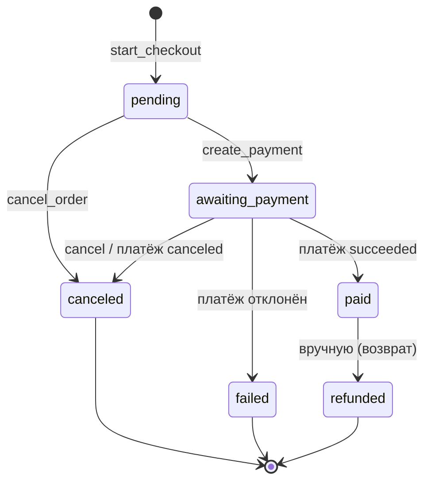

# Бизнес-правила

Все правила ниже реализованы в `bot/services/` (см. `architecture.md`:
хендлеры их не дублируют). Здесь — формулировки, а не код.

## Роли и доступ

| Правило | Реализация |
|---------|-----------|
| Администратор — только тот, чей ID есть в `ADMIN_IDS` | `AuthMiddleware` на каждом событии, `is_admin = ADMIN_IDS.contains(id)` |
| Отзыв доступа действует сразу, без перезапуска | Права не кэшируются в профиле: пересчёт на каждом событии |
| Покупатель не видит админ-команды в меню «/» | `set_bot_commands` ставит `BotCommandScopeChat` со списком админ-команд |
| Админские FSM-опросы недоступны не-админу | Роутер `admin` подключен первым, его корневые фильтры — `IsAdminFilter` |
| Событие без пользователя не трогает БД | `DbSessionMiddleware` и `AuthMiddleware` проверяют `event.from_user` |

## Каталог и товары

- В каталоге показываются только `is_active = true` товары, сортировка по
  `id` (порядок добавления). Пагинация — 5 товаров на страницу
  (`CATALOG_PAGE_SIZE`).
- Скрытый товар (`is_active = false`) исчезает из витрины, но остаётся
  доступным в `/products` и по slug для админа
  (`get_any_by_slug` против `get_by_slug`).
- Товар не удаляется физически: `purchases.product_id` имеет
  `ON DELETE RESTRICT`, потому что оплаченный доступ должен пережить товар.
- `slug` генерируется из названия: транслит кириллицы, lowercase, не-[a-z0-9]
  → `-`, максимум 48 символов, при коллизии суффикс `-2`, `-3`, ...
  (`build_slug` + `ProductService._unique_slug`).
- `file_url` товара **не попадает** в `ProductCard` и не отображается в
  карточке. Единственный путь получить ссылку —
  `get_file_url_for_owner(user_id, product_id)`, который проверяет покупку.

### Повторная покупка

`require_not_owned(user_id, card)` бросает `AlreadyPurchasedError`, если у
пользователя уже есть покупка этого товара. Проверка по паре
`(user_id, product_id)`, а не по «последнему заказу»: товар, по которому
сделан `refunded`, снова можно купить, когда покупка удалена/закрыта.

## Деньги

- Все суммы — целые копейки. `float` запрещён; `Decimal` используется
  только внутри `bot/services/money.py` для форматирования.
- Допустимый ввод цены: до 8 целых знаков и не больше 2 дробных, разделитель
  `.` или `,`, пробелы (включая NBSP) игнорируются — `1990`, `1990.50`,
  `1 990,00`. Всё остальное → `InvalidAmountError`.
- Вывод: `1 990,00 ₽` для RUB, символы `$`/`€` для USD/EUR, иначе код валюты.
- Комиссии, скидки и промокоды в текущей версии не рассчитываются: к оплате
  всегда ровно `price_kopecks` единственного товара заказа. Заказ
  одно-позиционный, хотя схема (`items_snapshot` как список) допускает
  несколько.

## Жизненный цикл заказа

| Правило | Зачем |
|---------|-------|
| Заказ создаётся **до** обращения в YooKassa | Пользователь видит подтверждение и сумму, даже если провайдер недоступен |
| Цена фиксируется в `total_kopecks` и `items_snapshot` | Правка цен в каталоге не меняет уже оформленные заказы |
| Запись `Payment` создаётся **до** HTTP-вызова | «Потерянный» ответ YooKassa не оставляет счёт без следа в БД |
| `Idempotence-Key = payment.id` | Повтор после таймаута не создаёт второй счёт |
| Уже существующий незавершённый счёт переиспользуется | Повторное нажатие «Оплатить» не плодит дубли в провайдере |
| Переход статуса — атомарный `UPDATE ... WHERE status IN (...)` | Гонка webhook и кнопки: успех обработает ровно один вызов |
| Отмена локальная: счёт в YooKassa не отменяется | Клиент умеет только создавать/читать; счёт протухает сам. Если платёж всё же пройдёт, заказ уже терминальный и покупок не создастся — возврат руками админа, поэтому в схеме есть `refunded` |
| Открытые статусы — `pending`, `awaiting_payment` (`OPEN_STATUSES`) | «Продолжить оплату» и защита от оплаты закрытого заказа |

## Подтверждение оплаты и выдача

Порядок, в котором деньги становятся товаром:

1. `sync_payment_status` (кнопка) или `handle_provider_event` (вебхук)
   сохраняют статус провайдера в `payments`.
2. `_settle_order` пытается перевести заказ в `paid`. Если `UPDATE` не задел
   строк — заказ уже оплачен, повтор игнорируется, покупок не будет.
3. Только при успешном переходе создаются `purchases` по
   `items_snapshot[*].product_id`.
4. Выдача выполняется хендлером (`deliver_order`): он шлёт сообщения со
   ссылками и **после** успешной отправки вызывает `mark_delivered`.

Разделение «куплено» / «выдано» принципиально:

- `purchases` — право на товар, появляется в момент оплаты;
- `purchases.delivered_at` — факт отправки материалов покупателю.

Если Telegram отдал ошибку при отправке, покупка остаётся не выданной,
кнопка «Повторить выдачу» (`order:repeat_delivery:<id>`) дошлёт именно
недостающие позиции, а не весь заказ. `mark_delivered` идемпотентен:
повторный вызов сохраняет время первой выдачи.

| Правило | Реализация |
|---------|-----------|
| Чужой заказ недоступен | `OrderNotFoundError` при `order.user_id != user_id` — без различия «нет»/«чужой», чтобы не раскрывать существование заказов |
| Товар выдаётся только владельцу покупки | `get_file_url_for_owner` → `NotPurchasedError` |
| Заказ в терминальном статусе нельзя оплатить | `OrderStateError` в `_require_open_order` |
| Статус провайдера сохраняется целиком (`raw_response`) | Аудит разборов и спорных ситуаций |
| `paid_at` проставляется один раз | Условие `payment.paid_at is None` |

## Локализация

Приоритет выбора языка: сохранённый выбор пользователя
(`users.preferred_language`) → язык клиента Telegram (если поддерживается)
→ `DEFAULT_LANGUAGE` из конфига.

- `BOT_LANGUAGE_MODE` ограничивает набор доступных языков: `ru`, `en` или
  `all`. При одном языке `/language` не показывает переключатель.
- Локаль Telegram сравнивается по префиксу (`en-US`, `pt_BR` → `en`).
- Отсутствие ключа в словаре отдаёт сам ключ — в интерфейсе это заметно
  сразу, а не выглядит как пустое сообщение.
- Ключа нет в нужном языке — откат на русский.

## Ограничения частоты

Скользящее окно на отправителя: 6 событий за 5 секунд
(`DEFAULT_BURST`, `DEFAULT_WINDOW_SECONDS`). Превышение — ответ
«Слишком часто. Подождите 5 сек.» без открытия транзакции БД.

- Один лимитер на `message` и `callback_query`: раздельные счётчики
  обходились бы чередованием «кнопка — команда».
- События без `from_user` не ограничиваются.
- Хранилище счётчиков — память процесса; счётчики давно молчавших
  пользователей вычищаются (от 128 ключей, grace = одно окно).

## Рассылка

- Адресаты — только `users.is_active = true`.
- Обязательное подтверждение с числом адресатов перед отправкой: список
  берётся заново в момент подтверждения, между шагами опроса могли
  зарегистрироваться новые пользователи.
- Отправляется текст, а не медиа: бот не хранит медиабиблиотеку.
- Результат — «доставлено N из M». Ошибки `TelegramForbiddenError`
  (пользователь заблокировал бота) и `TelegramAPIError` не валят рассылку:
  получатель помечается недоставленным.
- При пустом тексте подтверждение не показывается: рассылка прерывается со
  ссылкой на устаревшие кнопки.

## Права на данные

- Секреты (`BOT_TOKEN`, `DB_PASSWORD`, `YOOKASSA_SECRET_KEY`) только в
  `.env`; `Settings` объявляет их `repr=False`, чтобы они не попадали в дампы
  и логи.
- `ENVIRONMENT=production` включает дополнительную валидацию: пустой пароль
  БД, плейсхолдеры (`change-me`, `replace`, ...) и `PUBLIC_BASE_URL` без
  `https://` — старт невозможен.
- Пользователю никогда не показываются внутренние сообщения исключений:
  доменные ошибки несут заранее подготовленный `user_message`, остальные
  получают generic-подсказку (`common.error`).

## Что сознательно не реализовано

| Не реализовано | Почему |
|----------------|---------|
| Вебхук YooKassa как основной путь подтверждения | Нужен публичный HTTPS-эндпоинт; в dev его нет. Логика `handle_provider_event` готова, не подключён только HTTP-слой |
| Частичные возвраты, `waiting_for_capture`/`capture` | Клиент умеет создавать и читать платежи; для продаж цифровых товаров хватает immediate capture |
| Мульти-позиционный заказ в UI | Схема и `items_snapshot` это допускают, но витрина продаёт по одному товару |
| Redis для FSM и троттлинга | Один контейнер; при масштабировании — см. `decisions.md` |
| Экранирование HTML пользовательского ввода | В сообщения подставляются только данные из БД, введённые администратором; при добавлении UGC это станет обязательным |
