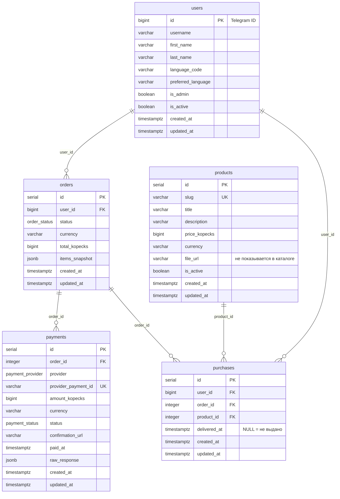

# Схема БД

PostgreSQL 15, SQLAlchemy 2.x (async, asyncpg), Alembic.
Актуальный head: `f091473a7049` (после `95631e009389`).

## ER-диаграмма



## users

Первичный ключ — сам Telegram ID (`autoincrement=False`): дополнительных
идентификаторов нет, а связь с внешним миром всегда по нему.

| Колонка | Тип | Примечание |
|---------|-----|-----------|
| `id` | `BIGINT PK` | Telegram ID пользователя |
| `username` | `VARCHAR(64) NULL` | Без `@` |
| `first_name` / `last_name` | `VARCHAR(128) NOT NULL DEFAULT ''` | Перезаписываются на каждом событии |
| `language_code` | `VARCHAR(8) NOT NULL DEFAULT 'ru'` | Локаль клиента Telegram, перезаписывается автоматически |
| `preferred_language` | `VARCHAR(8) NULL` | Явный выбор пользователя; `NULL` — «как в Telegram» |
| `is_admin` | `BOOLEAN NOT NULL DEFAULT false` | Пересчитывается из `ADMIN_IDS` на каждом событии |
| `is_active` | `BOOLEAN NOT NULL DEFAULT true` | Флаг «не получать рассылки» |

Разделение `language_code` / `preferred_language` обязательно: Telegram
присылает язык клиента в каждом событии, и без отдельного поля выбор
пользователя затирался бы следующим сообщением.

## products

| Колонка | Тип | Примечание |
|---------|-----|-----------|
| `id` | `SERIAL PK` | |
| `slug` | `VARCHAR UNIQUE NOT NULL` | ASCII, транслит с кириллицы; используется в callback-данных и deep-link |
| `title` | `VARCHAR NOT NULL` | |
| `description` | `VARCHAR NOT NULL DEFAULT ''` | |
| `price_kopecks` | `BIGINT NOT NULL` | Копейки, не рубли |
| `currency` | `VARCHAR NOT NULL DEFAULT 'RUB'` | |
| `file_url` | `VARCHAR NOT NULL` | **Никогда** не отдаётся в каталоге и не попадает в `ProductCard` |
| `is_active` | `BOOLEAN NOT NULL DEFAULT true` | Снят с продажи → скрыт от покупателей, виден админу |

Удаление товара не предусмотрено: `purchases.product_id` имеет
`ON DELETE RESTRICT`, чтобы оплаченный доступ нельзя было «удалить вместе с
товаром». Снятие с продажи — `is_active = false`.

## orders

| Колонка | Тип | Примечание |
|---------|-----|-----------|
| `id` | `SERIAL PK` | Номер заказа в сообщениях |
| `user_id` | `BIGINT FK→users.id ON DELETE CASCADE` | |
| `status` | `ENUM order_status NOT NULL DEFAULT 'pending'` | |
| `currency` | `VARCHAR NOT NULL DEFAULT 'RUB'` | |
| `total_kopecks` | `BIGINT NOT NULL` | Заморозка суммы на момент оформления |
| `items_snapshot` | `JSONB NOT NULL DEFAULT '{}'` | Заморозка состава |

`items_snapshot` — protection от правок каталога:

```json
{"items": [{"product_id": 12, "slug": "kurs-po-python",
            "title": "Курс по Python", "price_kopecks": 199000}]}
```

По `items_snapshot[*].product_id` сервис создаёт покупки, поэтому заказ
воспроизводим даже после изменения или сокрытия товара.

Индексы: `ix_orders_user_id`, `ix_orders_status`,
`ix_orders_user_status (user_id, status)` — последний обслуживает запрос
«открытые заказы пользователя».

### Порядок значений `order_status`

`pending` → `awaiting_payment` → `paid` | `canceled` | `failed` | `refunded`.
Терминальные: `paid`, `canceled`, `failed`, `refunded`
(`OrderStatus.is_terminal`).

## payments

| Колонка | Тип | Примечание |
|---------|-----|-----------|
| `order_id` | `INT FK→orders.id ON DELETE CASCADE` | Один заказ может иметь несколько платежей |
| `provider` | `ENUM payment_provider` | Сейчас только `yookassa` |
| `provider_payment_id` | `VARCHAR(64) UNIQUE NULL` | NULL до ответа провайдера |
| `amount_kopecks` | `BIGINT NOT NULL` | |
| `currency` | `VARCHAR(3) NOT NULL DEFAULT 'RUB'` | |
| `status` | `ENUM payment_status NOT NULL DEFAULT 'pending'` | `pending` / `processing` / `succeeded` / `canceled` |
| `confirmation_url` | `VARCHAR NULL` | Ссылка для пользователя |
| `paid_at` | `TIMESTAMPTZ NULL` | Проставляется один раз при успехе |
| `raw_response` | `JSONB NOT NULL DEFAULT '{}'` | Последний ответ провайдера — аудит |

`UNIQUE (provider_payment_id)` — защита от дублей при повторной доставке
webhook. Индексы: `ix_payments_order_id`, `ix_payments_status`,
`ix_payments_order_status`.

## purchases

Факт выданного доступа: «пользователь имеет право на этот товар».

| Колонка | Тип | Примечание |
|---------|-----|-----------|
| `user_id` | `BIGINT FK→users.id ON DELETE CASCADE` | |
| `order_id` | `INT FK→orders.id ON DELETE CASCADE` | NOT NULL: покупка всегда привязана к оплате |
| `product_id` | `INT FK→products.id ON DELETE RESTRICT` | |
| `delivered_at` | `TIMESTAMPTZ NULL` | `NULL` — оплачено, но материалы не отправлены |

Ограничение `uq_purchase_order_product (order_id, product_id)` — одна выдача
товара в рамках заказа. Индексы по каждому из трёх FK.

Право на файл проверяется по `(user_id, product_id)`, а не по заказу: это
разрешает повторную покупку того же товара (например, после `refunded`) и
не требует «самой последней» выдачи.

## Enum-типы

Три нативных `ENUM`: `order_status`, `payment_status`, `payment_provider`.
Во всех пишется `values_callable`, переводящий имена членов в значения
(`PENDING` → `pending`), иначе PostgreSQL хранил бы имена, а внешний API и
вся логика оперируют строчными значениями.

## Миграции

- `95631e009389` — начальная схема: `products`, `users`, `orders`,
  `payments`, `purchases`, индексы, FK и enum-типы.
- `f091473a7049` — `users.preferred_language VARCHAR(8) NULL`.

`downgrade` начальной миграции удаляет enum-типы сырым
`DROP TYPE IF EXISTS`, потому что в Alembic 1.20 нет `op.drop_enum`.

Правила:

1. Схема меняется **только** миграциями; `create_all()` в рантайме не
   вызывается.
2. Новые миграции — `alembic revision --autogenerate -m "..."`, затем
   автогенерацию читать руками (Alembic не видит переименования и часть
   типов).
3. Файлы миграций не удаляются и не редактируются задним числом — только
   добавляются новые.
4. В `docker-compose` бот накатывает схему сам:
   `alembic upgrade head && python main.py`.
